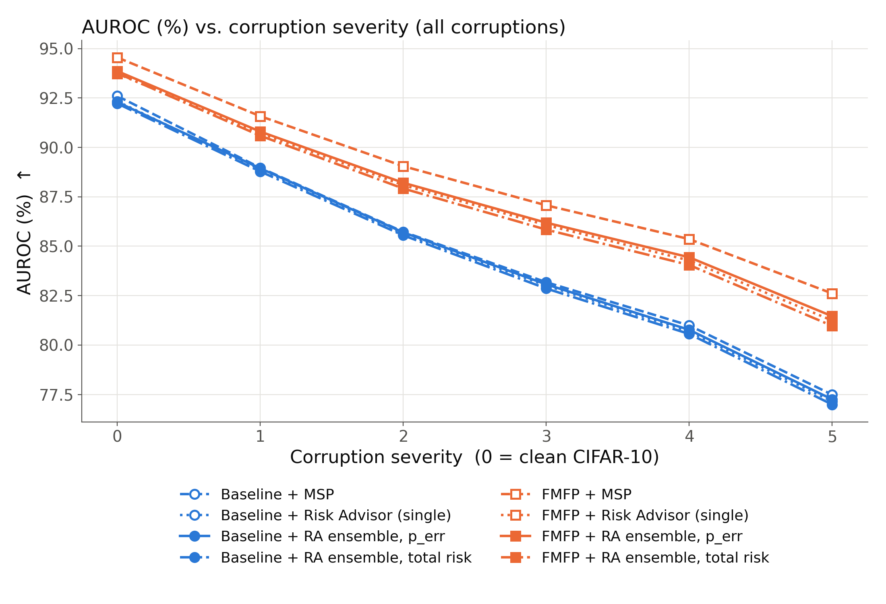
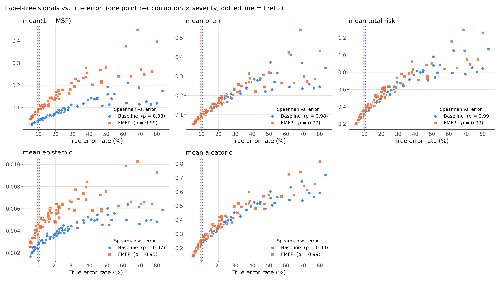

## DS340W Group 2 — Does a model notice its own failures as the input drifts?

Penn State DS 340W team project on AI failure detection. We take a CIFAR-10
ResNet-18, push its inputs gradually away from the training distribution with
CIFAR-10-C (corruption severity 0 → 5), and measure how well the model and a
post-hoc meta-model can tell **which predictions are wrong** and **when the
deployed model as a whole should be retrained**, without labels.

### Research question

As the input distribution shifts step by step, (1) does per-sample failure
prediction (MSP vs. a Risk Advisor) stay reliable, (2) does flat-minima training
(FMFP) help it stay reliable, and (3) can label-free uncertainty signals track the
true error rate well enough to act as a retraining trigger?

### Parent papers and their roles

| | Paper | Role in this project |
|---|---|---|
| 1 | Zhu et al., *Rethinking Confidence Calibration for Failure Prediction*, ECCV 2022 | Base code (this repo is a fork of FMFP). Supplies the base models — a Baseline ResNet-18 and an FMFP (SAM + SWA) ResNet-18 — and the failure-prediction metrics (AUROC, AUPR-Error, AURC, E-AURC, FPR@95TPR). |
| 2 | Lahoti et al., *Responsible Model Deployment via Model-Agnostic Uncertainty Learning* | The **Risk Advisor**: an ensemble of stochastic gradient boosted trees that predicts the base model's errors and splits risk into model uncertainty (`p_err`), aleatoric and epistemic uncertainty; `total_risk` is their sum. |
| 3 | *Temporal quality degradation in AI models*, Scientific Reports 2022 | The **monitoring question**: performance degrades silently after deployment and there is no label-free retraining trigger. We use its relative error `Erel = current error / training-time error` and the `Erel > 2` "no longer accurate" threshold. |

### What we changed relative to the original FMFP code

Training logic and hyperparameters in `main_base.py`, `main_fmfp.py` and
`train_*.py` are unchanged; only compatibility fixes were made there.

* Windows / Python 3.10 compatibility: `resource` guarded in `main_base.py`,
  `collections.abc.Iterable` in `utils/utils.py`, `--gpu` default `0` in
  `main_fmfp.py`, optional `args.num_workers` in `utils/data.py` (default still 4).
* `risk_advisor.py` — Risk Advisor ensemble with the Paper 2 uncertainty decomposition.
* `cifar10c.py` — memory-mapped CIFAR-10-C reader, one corruption file at a time.
* `fp_metrics.py` — failure-prediction metrics for any confidence score.
* `eval_shift.py` — sweep over clean + 15 corruptions × 5 severities, inference cache,
  scorers, label-free monitoring.
* `monitor.py` — per-group label-free signals, `Erel`, Spearman, trigger AUROC.
* `plot_shift.py`, `plot_monitor.py`, `plot_style.py` — slide-ready figures.
* `scripts/run_midterm.ps1` — the whole pipeline in one script.
* `tests/test_smoke.py` — GPU-free smoke tests.
* `export_cifar10_splits.py` — writes the 45,000 / 5,000 / 10,000 train / validation /
  test split used by `utils/data.py` (NumPy seed 42) to `split_data/` (not committed).
* `requirements.txt` — Python dependencies (unpinned).
* `FMFP_ORIGINAL_README.md` — the original FMFP README.

### Datasets

* **CIFAR-10** — <https://www.cs.toronto.edu/~kriz/cifar.html>. Downloaded
  automatically to `./data/cifar10_data/` the first time any script runs.
  `utils/data.py` holds out 5,000 training images (fixed seed 42) as the validation
  split; the model trains on the other 45,000. `python export_cifar10_splits.py`
  exports the same split as arrays if you need it outside this code.
* **CIFAR-10-C** — <https://zenodo.org/records/2535967> (≈2.9 GB). Unpack it so
  that `./data/CIFAR-10-C/` contains `labels.npy` and the 15 corruption `.npy` files.

### Setup

Python 3.10, PyTorch with CUDA 12.8 (tested on Windows 11 + RTX 5070, torch 2.11.0+cu128):

```
python -m venv .venv
.venv\Scripts\activate
pip install torch torchvision --index-url https://download.pytorch.org/whl/cu128
pip install -r requirements.txt
```

### Running

**1. Base models** (201 epochs each)

```
python main_base.py --model resnet18 --epochs 201 --run 1 --gpu 0
python main_fmfp.py --model resnet18 --epochs 201 --run 1 --gpu 0
```

`main_*.py` save to `save_path + data + '_' + model + '_' + method`, so the
checkpoints land at:

* Baseline: `./output/cifar10_resnet18_Baseline/model.pth` (capital **B**, from `--method Baseline`)
* FMFP: `./output_flat/cifar10_resnet18_fmfp/model.pth` (the SWA-averaged model)

With `--run 1` the scripts print a NaN warning when computing the std over runs;
that is expected and harmless.

**2. Evaluation under shift**

```
python eval_shift.py --ckpt ./output/cifar10_resnet18_Baseline/model.pth --tag baseline
python eval_shift.py --ckpt ./output_flat/cifar10_resnet18_fmfp/model.pth  --tag fmfp
```

Useful options: `--corruptions gaussian_noise fog` (subset), `--limit N` (first N
images per corruption/severity), `--ra_members 10`, `--ra_features logits|logits+emb`,
`--pca_dim 32`, `--num_workers 0`, `--use_cache` (reuse `output_shift/cache_{tag}.npz`
and skip GPU inference; use it to try other Risk Advisor settings).

**3. Figures**

```
python plot_shift.py                  # AUROC vs severity
python plot_shift.py --metric aurc    # or eaurc, fpr95, aupr_err, acc
python plot_shift.py --corruption fog # a single corruption instead of the pooled rows
python plot_monitor.py                # label-free signals vs true error
```

**Everything at once (PowerShell)**

```
powershell -ExecutionPolicy Bypass -File scripts\run_midterm.ps1 -FmfpCkpt .\output_flat\cifar10_resnet18_fmfp\model.pth
```

`-Python <path to python.exe>` picks the interpreter (default: `.venv` in the repo,
else `python`). Steps can be skipped with `-SkipTrain`, `-SkipEvalBaseline`,
`-SkipEvalFmfp`, `-SkipPlot`; `-UseCache`, `-Limit`, `-Corruptions a,b`,
`-RaMembers`, `-RaFeatures`, `-DataPath`, `-Cifar10cPath` are passed through. The
log with per-step timings is written to `output_shift/run_midterm_<time>.log`.

**Quick test on real data** (a minute or two once the checkpoints exist):

```
python eval_shift.py --ckpt ./output_flat/cifar10_resnet18_fmfp/model.pth --tag fmfp --limit 200 --corruptions gaussian_noise fog
python plot_shift.py
python plot_monitor.py
```

A `--limit` run writes its own cache, so drop `--use_cache` (or delete
`output_shift/cache_{tag}.npz`) before the full run.

**Smoke tests** (no GPU, no CIFAR-10-C):

```
python tests/test_smoke.py      # or: python -m pytest tests
```

### Outputs (`./output_shift/`)

| File | Content |
|---|---|
| `results.csv` | `tag, corruption, severity, scorer` + acc, auroc, aupr_err, aurc, eaurc, fpr95. One row per scorer for each of the 76 groups (`clean` + 15 corruptions × 5 severities) and for `corruption=all` (all corruptions of a severity pooled; severity 0 = clean). Re-running a tag replaces its rows. |
| `monitor_{tag}.csv` | Per group: mean(1 − MSP), mean p_err, mean total_risk, mean epistemic, mean aleatoric, true error rate, `Erel`, `trigger = Erel > 2`. |
| `monitor_summary.csv` | Per tag × signal: Spearman correlation with the true error rate over the 76 groups, and AUROC of the signal as a retraining trigger (`label = Erel > 2`). |
| `cache_{tag}.npz` | Logits, float16 penultimate embeddings, correctness, corruption, severity (not committed). |
| `*_vs_severity*.png`, `monitor_signals.png` | Figures (white background, dpi 200). |

Scorers (all oriented so that a higher score means "more likely correct"):
`msp` (max softmax probability), `ra_single` (one GBT, `1 − p_err`),
`ra_ens_p_err` (ensemble, `1 − p_err`), `ra_ens_total` (ensemble, `−total_risk`).

### Sanity check

FMFP checkpoint, clean CIFAR-10 test set, MSP, evaluated with `eval_shift.py` vs.
the numbers `main_fmfp.py` reported at the end of training:

| | Acc | AUROC | AUPR-Err | AURC | E-AURC | FPR95 |
|---|---|---|---|---|---|---|
| `main_fmfp.py` (`utils/metrics.py`) | 95.33 | 94.55 | 45.70 | 3.93 | 2.82 | 34.26 |
| `eval_shift.py` (`fp_metrics.py`) | 95.33 | 94.55 | 45.70 | 3.93 | 2.82 | 34.48 |

The only gap is FPR95: `utils/metrics.py` takes the ROC point whose TPR is
*closest* to 0.95, `fp_metrics.py` the first point with TPR *≥* 0.95.

### Deviations from parent papers

* **Risk Advisor trained on validation errors, not training errors (Paper 2).**
  Paper 2 fits the advisor on the base model's training-set errors. A ResNet-18
  trained for 201 epochs makes almost no errors on its own training data, so we
  fit on the 5,000-image held-out validation split instead. That split has only
  about 220 errors for FMFP, which limits how much the advisor can learn.
* **Features (Paper 2).** Paper 2 feeds the advisor the input features. Our inputs
  are images, so the default advisor uses 9 statistics of the logits (top-3
  probabilities, top-1/top-2 margins, entropy, max logit, logit std, logsumexp).
  `--ra_features logits+emb` adds a 32-d PCA of the penultimate ResNet-18 embedding
  (fit on the validation split) as a stand-in for input features.
* **Ensemble diversity (Paper 2).** Members differ only in `random_state` with row
  subsampling (`subsample=0.8`); hyperparameters are fixed (200 trees, depth 3,
  learning rate 0.05) and not tuned. Each member is fit on the correct/incorrect
  label and `p_err = 1 − P(correct)`, which is the same model as fitting on the
  error label and keeps `n_members=1` identical to the earlier single-GBT advisor.
* **Units of the risk decomposition (Paper 2).** Entropies are in bits so that
  `p_err`, aleatoric and epistemic each lie in [0, 1] before being summed into
  `total_risk`. The choice only changes the relative weight of the terms in the
  sum; per-term rankings (AUROC, Spearman) are unaffected.
* **Simulated drift instead of time (Paper 3).** Paper 3 studies degradation over
  real deployment time. We stand in corruption severity for time and treat each of
  the 76 (corruption, severity) groups as one deployment batch. "Training-time
  error" in `Erel` is the clean CIFAR-10 test error of the same model. The trigger
  is scored as an AUROC over the 76 groups, not as an online change-point detector.
* **Single run (Paper 1).** Paper 1 averages 3 runs; we train one Baseline and one
  FMFP model (`--run 1`).
* **Pooled severity rows.** `corruption=all` rows compute each metric on all
  corruptions of a severity concatenated, not as an average of per-corruption metrics.

### Results

Midterm run: one Baseline and one FMFP ResNet-18 (201 epochs each), all 15
CIFAR-10-C corruptions × 5 severities, Risk Advisor with 10 members on `logits`
features. Full numbers are in `output_shift/`.

Clean test set: Baseline Acc 94.72 / AUROC 92.60 / AURC 6.29; FMFP Acc 95.33 /
AUROC 94.55 / AURC 3.93. Validation errors available to the Risk Advisor:
257 (Baseline), 219 (FMFP).

**1. FMFP predicts failures better than the Baseline at every severity, and the gap grows with shift.**



MSP, all corruptions pooled (`corruption=all`):

| Severity | 0 | 1 | 2 | 3 | 4 | 5 |
|---|---|---|---|---|---|---|
| Accuracy, Baseline / FMFP | 94.72 / 95.33 | 86.85 / 88.90 | 80.89 / 83.90 | 74.23 / 77.90 | 66.40 / 70.64 | 54.43 / 58.90 |
| AUROC, Baseline | 92.60 | 88.97 | 85.73 | 83.18 | 80.99 | 77.49 |
| AUROC, FMFP | **94.55** | **91.58** | **89.05** | **87.07** | **85.36** | **82.61** |
| AUROC gap | +1.95 | +2.61 | +3.32 | +3.89 | +4.37 | +5.12 |
| AURC (×10³), Baseline / FMFP | 6.29 / **3.93** | 28.19 / **16.71** | 55.94 / **33.29** | 91.49 / **57.95** | 141.27 / **94.76** | 241.53 / **174.72** |

At severity 5 FMFP has the higher MSP AUROC on all 15 corruptions (largest gaps:
zoom_blur +7.8, defocus_blur +7.2, impulse_noise +6.3; smallest: brightness +2.6).
Noise corruptions are the hardest for both models (severity-5 AUROC 60–71).

**2. The Risk Advisor does not beat MSP.**

| AUROC, pooled | sev 0 | sev 1 | sev 3 | sev 5 |
|---|---|---|---|---|
| Baseline: MSP / RA single / RA ens p_err / RA ens total | 92.60 / 92.33 / 92.29 / 92.22 | 88.97 / 88.88 / 88.94 / 88.78 | 83.18 / 83.01 / 83.07 / 82.86 | 77.49 / 77.15 / 77.25 / 76.99 |
| FMFP: MSP / RA single / RA ens p_err / RA ens total | **94.55** / 93.73 / 93.86 / 93.76 | **91.58** / 90.72 / 90.80 / 90.59 | **87.07** / 86.07 / 86.19 / 85.84 | **82.61** / 81.24 / 81.46 / 80.97 |

* With FMFP, every Risk Advisor variant is 0.7–1.6 AUROC below MSP at every severity,
  and the gap widens with severity.
* With the Baseline, AUROC is within 0.5 of MSP, and AURC is slightly better than
  MSP at severities 1–5 (e.g. severity 2: 53.23 vs 55.94).
* The 10-member ensemble is at most 0.2 AUROC above a single GBT, and `total_risk`
  ranks failures slightly worse than `p_err`.
* Likely reasons: the advisor sees only logit statistics (little beyond what MSP
  already encodes), it learns from ~220–260 validation errors, and those errors
  come from clean data while it is evaluated under shift.

**3. Label-free signals track the true error rate closely across the 76 groups.**



| Signal | Spearman, Baseline | Spearman, FMFP | Trigger AUROC (Erel > 2), Baseline | FMFP |
|---|---|---|---|---|
| mean(1 − MSP) | 0.977 | 0.986 | 100.0 | 99.9 |
| mean p_err | 0.977 | 0.985 | 100.0 | 100.0 |
| mean total_risk | 0.987 | 0.986 | 100.0 | 99.9 |
| mean epistemic | 0.967 | 0.932 | 99.8 | 99.3 |
| mean aleatoric | 0.992 | 0.986 | 100.0 | 99.7 |

* Read the trigger AUROC with care: clean error is ~5%, so `Erel > 2` already fires
  at ~10–11% error, and 57 (Baseline) / 56 (FMFP) of the 76 groups are positives.
  The trigger task mostly separates "clean or mildly corrupted" from "corrupted",
  so all signals sit at the ceiling.
* Epistemic uncertainty is tiny (mean 0.002–0.01 bits): members that differ only in
  random seed and row subsample rarely disagree.
* At the same error rate FMFP's mean(1 − MSP) is higher than the Baseline's, i.e.
  FMFP is less overconfident under shift, which matches finding 1.

**Open items for the final report**

* A harder trigger evaluation (per-corruption Spearman, stricter Erel thresholds, or
  only groups near the threshold).
* The `logits+emb` Risk Advisor ablation, and more diverse ensemble members.
* More than one training run per method.

---

## Original work and attribution

FMFP was introduced in *Rethinking Confidence Calibration for Failure Prediction*
(Fei Zhu, Zhen Cheng, Xu-Yao Zhang, Cheng-Lin Liu, ECCV 2022,
[paper](https://www.ecva.net/papers/eccv_2022/papers_ECCV/papers/136850512.pdf)).
The FMFP training, model and utility files and `framework.png` derive from the
authors' public code, <https://github.com/Impression2805/FMFP>, which in turn
references <https://github.com/daintlab/confidence-aware-learning>. See the
included MIT `LICENSE` and `FMFP_ORIGINAL_README.md` for the original project
description. Everything listed under "What we changed" was added for this project. We
trained one Baseline and one FMFP ResNet-18 on CIFAR-10; this is not a
reproduction of the paper's full set of experiments.
